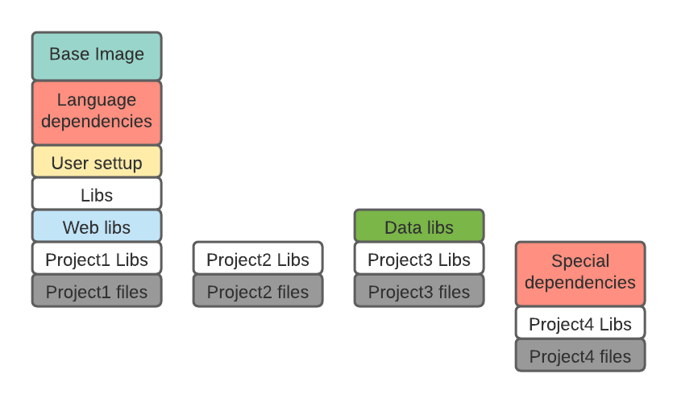
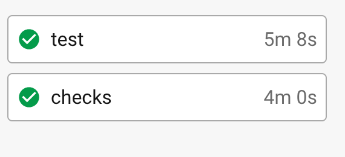
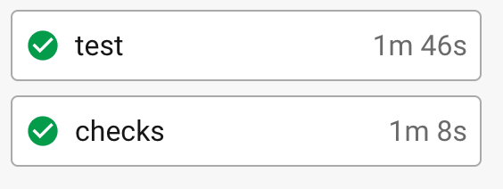
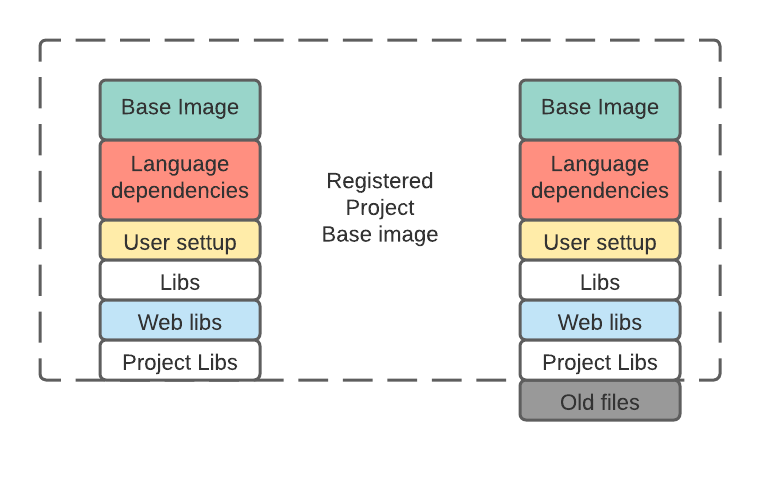
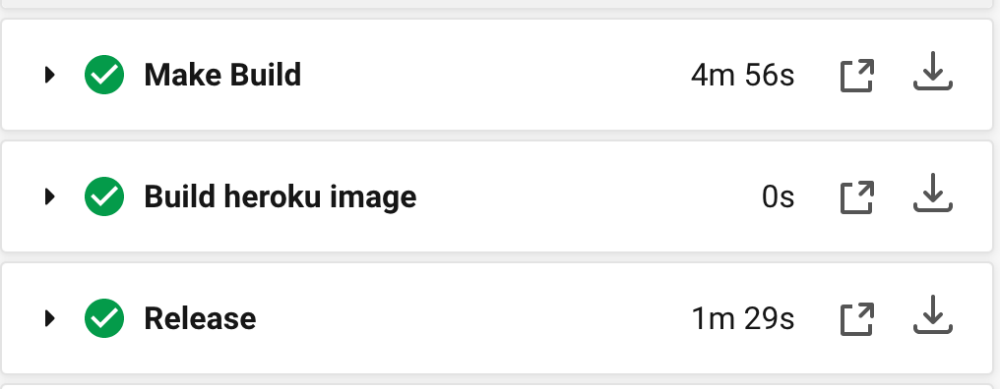
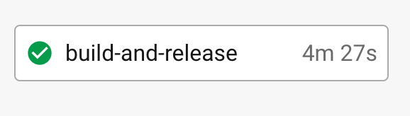
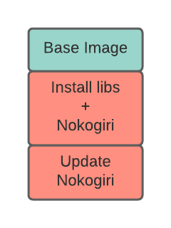

Docker
======

This project has build base images for serveral projects

## Motivation

Many projects have oftenly share the same docker setup or dependencies, so
a good repository for all Dockerfiles is needed.

At the same time projects cannot have just a huge docker image with all the dependencies
any project can have, so there are images for each project purpose, still, space usage
can be kept to a minimum by taking advantage of Docker layering

### Docker images and layers

Docker images store a layer for each command so that any image built on top, only the
new layers / commands needs to stored and when a container needs to be initialized,
the layers are collected and assembled

This can save space as long as 2 different projects share the common layers

This can also speed up tests on CI or deployments, as tests will have 0 or just a few
seconds for installing dependencies.

- Regular build

  

- Improoved build

  

Release can also be accelerated as only the last changed layer is built and pushed to a server which already
contains the same base.

- Regular release

  

- Improoved release

  

## Images Categories

The project has 4 categories of images
- Tool images: Images used as tools that have no circleci or production counter-parts
- Dev images: Images used in development which will then have a circleci and production counterpart
- Circleci images: Images optimized to run on CI (circleci) with extra testing / building tools
- Production images: Images without develpment dependencies designed to
  be lightweight and run in servers

## Multi-Stage build

Since a lot of dependency instalations generate extra garbage (source files, logs, etc)
a multi stage build can use an image for all the compilation, instalations and configurations
having the final result being copied to a final image which will then be released.

And added advantage is the this generates single layers for a lot of joint instalation commands
and, even though this can be an anti-pattern, this can reduce the layer count, specially when we
talk about images that rely on a base image already containing a lot of layers as some services
have a maximum layer limit (40 for Heroku).

Multi-Stage build add an extra hassle that when trying to rebuild the image, if the intermediate
build image has been deleted, the docker cachec cannot find it, so it has to rebuild it, but
the added base image advantages can overcome this problem.

### Dangers and pitfalls

Docker does not have a concept of deleting or updating a file, so such actions generate new layers
which store the file again

This is specially dangerous when building using multistage as files are copied from the build stage
image into the final image, so a check of which files are new and which already existed is needed
and this is done based on the type of dependency (npm files, ruby gems, etc)

## script image

Sometimes, script files must be shared by images which do not share a base, and sometimes those
scripts are only used in the build stage of a docker build, so an image was created to be a
script repository where scripts are copied from during docker build.

## Images

#### Tools
  - 
### Development
  - 
  - 
  - 
  -  (deprecated, use `python`)
  - 
  - 
  - 
  - 
  - 
  - 
  - 
  - 
  - 
### Circleci
  - 
  - 
  - 
  -  (deprecated, use `circleci_python`)
  - 
  - 
  - 
  - 
  - 
  - 
  - 
  - 
  - 
### Production
  - 
  - 
  - 
  - 
  - 
  - 
  - 
  - 
